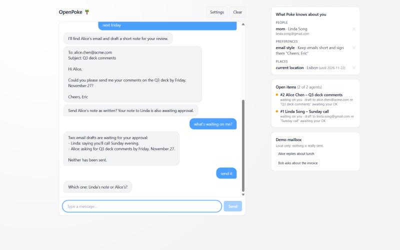
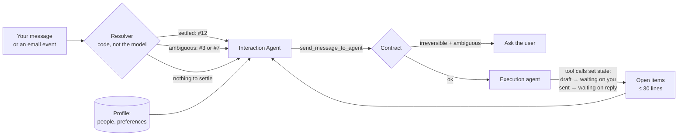
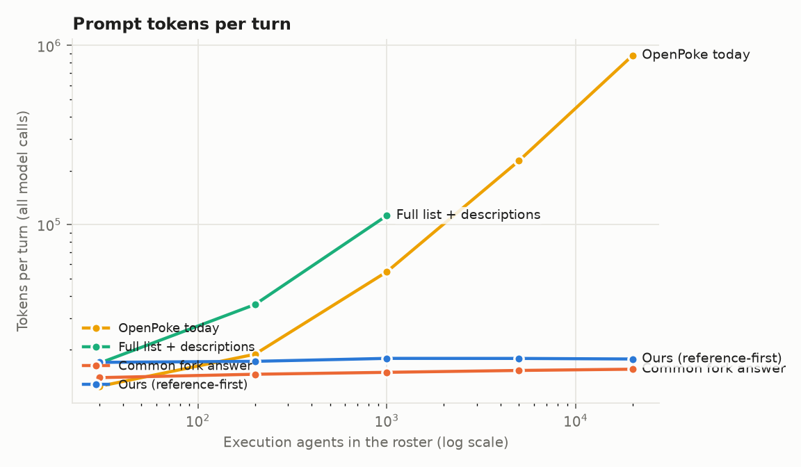
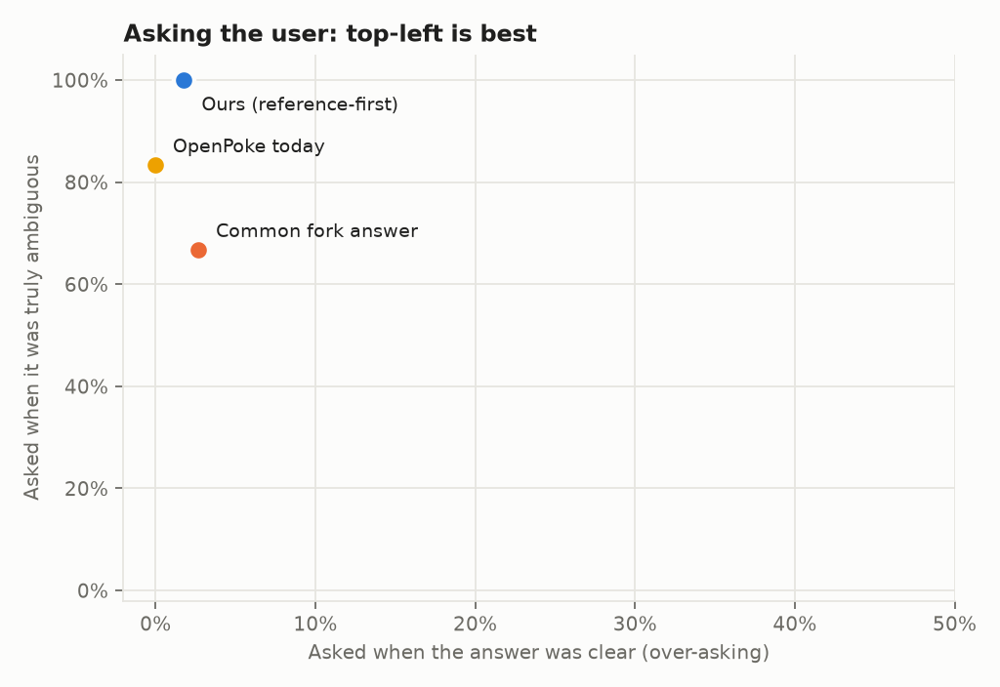
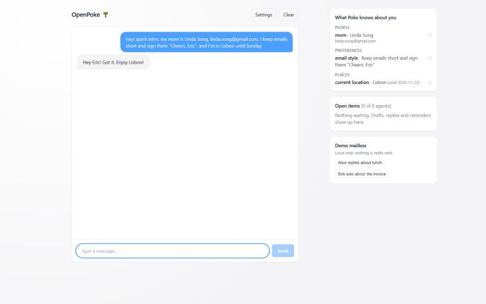

# OpenPoke, reference-first

My fork of [OpenPoke](https://github.com/shlokkhemani/openpoke), the open-source take on
[Poke](https://poke.com). It started as Interaction Company's "Agent Overload" take-home and
became the assistant I run for myself. Two things set it apart from upstream:

- **It doesn't drown in its own agents.** Poke stays accurate and cheap at 20,000 execution agents,
  and when "send it" could mean two drafts, it asks instead of guessing.
- **It learns who you are.** Your people, how you like your emails, where you are this week. It
  learns from your own messages only, so a stranger's email can't plant a "fact".



*Two drafts open, the user types "send it", and Poke asks which one. The send tool refuses an
irreversible step on an ambiguous reference, so this is enforced in code. The panel on the right
shows what Poke has learned and the items it's tracking.*

## The problem

Upstream's Interaction Agent sees the name of every execution agent ever created, on every turn,
and decides whether to reuse one by matching the name string. After a few months that's thousands
of names in the prompt: wrong reuses ("Email to Alice" picks up the wrong Alice), duplicates, and a
prompt that grows without limit. At 20,000 agents a single turn costs $0.44–0.79.

The forks that took this on (20-odd of upstream's 146) mostly answer with richer agent cards plus
retrieval. That helps, but their own
write-ups show what's left: deciding which draft "send it" means, which Alice, or whether a message
is an old thread or new work. Those are reference questions, and the data to answer most of them is
already in the system.

## What this fork does

- **Shows open items, not history.** Poke sees what's in flight: drafts waiting on you, replies it's
  waiting for, reminders. It's capped at about 30 lines, plus a search tool for everything older.
  Open items track how busy you are, not how long you've used Poke (Little's Law: about 60 items
  for 30 tasks a day that take 2 days).
- **Resolves references in code.** Thread ids, draft ids, contacts, aliases learned from your
  clarifications, and "the one Poke just showed you" settle most references before the model guesses;
  exact ids always outrank semantic matches. Optional OpenAI embeddings add semantic recall for
  paraphrases when `OPENAI_API_KEY` is set; without a key search stays lexical. An
  incoming reply wakes the agent that owns its thread, and closes the item that was waiting on it.
- **Asks when it's truly ambiguous.** An irreversible step on an ambiguous reference is refused
  until you choose. Work that another agent owns is redirected to it, and look-alike new work is
  flagged.
- **Remembers you.** A private profile in local SQLite: people, preferences, places, routines, and
  temporary facts that expire on their own. You can see it and delete any of it.



## Results

All numbers come from live model runs against synthetic worlds of 30 to 20,000 agents. The headline
split was written after all tuning, frozen with a digest of the routing code, and run once. The
runner refuses to rerun it or to run it on changed code.

| Agents | Model | OpenPoke today | Common fork answer | **This fork** |
|---:|---|---:|---:|---:|
| 30 | Haiku 5.5 | 97% | 97% | **100%** |
| 1,000 | Haiku 5.5 | **100%** | 90% | 94% |
| 20,000 | Haiku 5.5 | not run ($0.44/turn) | 87% | **100%** |
| 30 | GPT-6.1 | 87% | 90% | **100%** |
| 1,000 | GPT-6.1 | 81% | 84% | **90%** |

Two paired differences clear zero: +13 points [+3, +26] over the common fork answer at 20,000
agents, and +13 [+3, +26] over OpenPoke today at 30 agents on GPT-6.1. On Haiku at 1,000 agents,
OpenPoke today wins (100% vs 94%). Across every cell this fork made **zero wrong reuses**, and it
asked on 20 of 21 truly ambiguous requests. OpenPoke today asked on none of them on GPT-6.1.

<p>
  
  
</p>

On other people's published tests, this fork is best on KareemElMaaddawy's (94% and 98% against
81–91%). On draggle's 50-agent test, the common fork answer is best: at that size, retrieval plus
good cards is enough. The full write-up has the method, every result with its interval, what each
piece is worth, and the misses: [`docs/agent-overload.md`](docs/agent-overload.md).

## A Poke that knows you



From "my mom is Linda Song, linda.song@gmail.com. I keep emails short and sign them 'Cheers, Eric'.
and I'm in Lisbon until Sunday", Poke saves three facts. Then "email my mother" drafts to Linda,
short and signed the way you asked. "I moved to Toronto" replaces the old city, "I sold my car"
retires the car, and the Lisbon fact drops out on Monday.

The learner reads only your own words. On 20 held-out cases frozen before the run, it scores 97–100%
on three models, against 63–68% for the version it replaced, with no false writes. "Ok" after Poke
relays an email confirms nothing.

## Try it

You need Python 3.10+, Node 18+ and one model key: OpenRouter, OpenAI, or Anthropic
(`OPENPOKE_PROVIDER=anthropic` + `ANTHROPIC_API_KEY`).

```bash
git clone https://github.com/ChardXBT/openpoke && cd openpoke
python3 -m venv .venv && source .venv/bin/activate      # Windows: .\.venv\Scripts\Activate.ps1
pip install -r server/requirements.txt
npm install --prefix web
cp .env.example .env    # add OPENROUTER_API_KEY, or OPENPOKE_PROVIDER=openai + OPENAI_API_KEY
echo "OPENPOKE_FAKE_GMAIL=1" >> .env     # a local demo inbox: nothing is ever sent
python -m server.server                  # API on 127.0.0.1:8001
npm run dev --prefix web                 # chat on http://localhost:3000
```

The five-minute demo, with what to type and what to point at, is in
[`docs/demo-script.md`](docs/demo-script.md). To use your real Gmail, drop `OPENPOKE_FAKE_GMAIL`, add
your [Composio](https://composio.dev) keys, and connect in *Settings → Gmail*. How to run it as your
own assistant (privacy, cost, what it stores) is in [`docs/personal-use.md`](docs/personal-use.md).

```bash
python -m pytest                       # 262 offline tests, no keys needed
python -m evals.harness.runner --setups b0,b2,ours --split dev --sizes 30,1000 \
    --model anthropic/claude-haiku-5.5 --max-usd 2 --out evals/runs/try
python -m evals.memory.run --models openai:gpt-6-luna --out evals/runs/memory-try
```

`OPENPOKE_ROUTER=legacy` restores upstream's routing byte for byte.

## Also fixed along the way

- The API listened on every network interface with CORS `*` and no auth, so anyone on your Wi‑Fi,
  or any web page you had open, could make it read and send your email. It now listens on
  `127.0.0.1` and accepts browser calls only from the web app.
- Two runs on the same agent interleaved and could double-send. Runs on one agent are now serialized.
- Execution agents replayed their whole history on every call. Now it's the last 20 requests.
- OpenPoke didn't start on Windows (`fcntl`), and its configured model had been retired.

## Docs

| | |
|---|---|
| [`docs/agent-overload.md`](docs/agent-overload.md) | the write-up: problem, design, method, results, assumptions |
| [`docs/demo-script.md`](docs/demo-script.md) | the live demo, scene by scene |
| [`docs/personal-use.md`](docs/personal-use.md) | running it as your own assistant |
| [`docs/research/2026-11-20-fork-survey.md`](docs/research/2026-11-20-fork-survey.md) | what the forks built and where it stopped working |
| [`evals/results/JOURNAL.md`](evals/results/JOURNAL.md) | every eval run, its cost, and every decision made along the way |

What's next lives in the [issues](https://github.com/ChardXBT/openpoke/issues).

## Credits

Built on [OpenPoke](https://github.com/shlokkhemani/openpoke) by Shlok Khemani, inspired by
Interaction Company's [Poke](https://poke.com). MIT, see [LICENSE](LICENSE).
