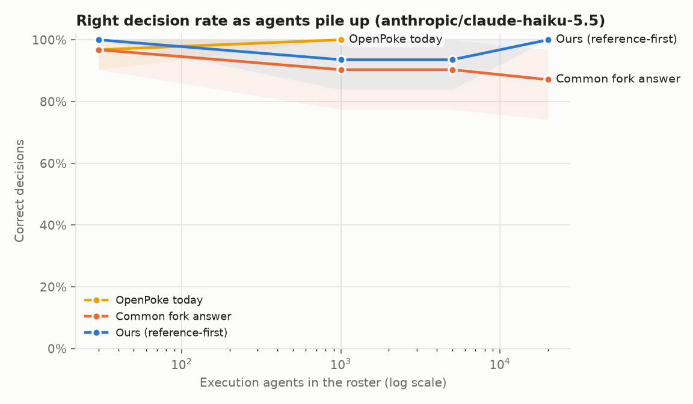
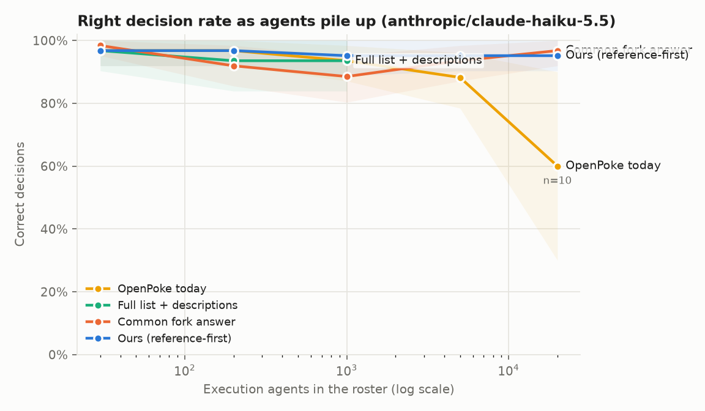

# Agent overload: reference-first routing

## The problem, reframed

OpenPoke's Interaction Agent (IA) sees every execution agent ever created, as a bare
name, on every turn, and decides spawn-vs-reuse by exact string match. After weeks of
use that is hundreds or thousands of names.

At least 20 public forks have attacked this (survey: `docs/research/2026-11-20-fork-survey.md`).
Nearly all of them converge on the same answer: give the model richer agent cards,
retrieve the top few, add a search tool and a duplicate guard. Their own write-ups show
where that stops working: the model asks the user on only 2 of 30 truly ambiguous cases,
reuses agents across people and topics, trades wrong reuse for duplicates, and still
loses accuracy as the roster grows.

Those residual errors are **reference errors**: which draft does "send it" mean, which
Alice, is this the old thread or new work. A model guessing from better cards is the wrong
tool for them. Most references can be settled from data the system already has, and what
cannot be settled is genuinely ambiguous, where the right move is to ask, not guess.

**Thesis.** Resolve references in code where the data allows; make "ambiguous, ask the
user" an outcome enforced in code; let the model choose only among what code could not
settle; and keep the prompt bounded by showing **open items**, not history.

**Why the prompt stays bounded.** Open items ≈ new tasks per day × days until done
(Little's Law). 30 tasks a day that close in about 2 days is about 60 open items, whether
the user has 500 agents or 200,000. The working set scales with how busy the user is,
not with how long they have used the product.

## What changed

| Piece | File | What it does |
|---|---|---|
| Agent registry | `server/services/execution/registry.py` | SQLite replaces `roster.json`: stable `#id`s, normalized names (no more "Email to Alice" vs "email to alice" duplicates), refs (contacts, threads, drafts, triggers, subjects), FTS5 index. Migrates `roster.json` once. |
| Open-loop state | `server/services/execution/loops.py` | States derived from what tools actually did: draft created → *waiting on you*; reply sent → *waiting on reply*; trigger → *scheduled*. Captured at tool time (logs truncate ids). Lapses stale waits, archives idle finished agents, never archives trigger owners. |
| Working set | `server/services/execution/working_set.py` | The `<agents>` block: open items (max 25), 5 recent, one "+N more" line. ≤ 31 lines at any roster size. |
| Search | `server/services/execution/search.py` | `search_agents` tool: exact references outrank wording; state and recency weighting; one contact cannot fill the list; FTS syntax-safe. |
| Resolver | `server/services/execution/resolver.py` | Rules in order: explicit (`#id`, thread/draft id, exact name; "invoice #402" is not agent #402) → inbound email (thread owner, else the item waiting on the sender) → short references ("send it", "did she reply?") against items Poke just surfaced → person named in the message, topic words break ties. Never raises. |
| Ambiguity contract | `server/agents/interaction_agent/tools.py` | `send_message_to_agent` refuses irreversible steps on ambiguous references (`needs_user_choice`), challenges a send aimed away from what the user meant (`confirm_target`), redirects work an agent already owns (`owned_by`), flags look-alike open work (`possible_duplicate`, overridable with `create_new`). |
| Prompt | `server/agents/interaction_agent/routing_prompt.md`, `agent.py` | Explains the agents view, `<routing_hint>`, `<related_agents>` and the tool's answers; replaces upstream's "reuse even if the name is unrelated". |
| Email events | `server/services/gmail/importance_watcher.py` | Notifications carry thread id and sender, so a reply wakes the agent that owns the conversation. |
| Learning from clarifications | `tools.py`, `resolver.py`, `registry.py` | When Poke has to ask "which one?", the user's phrase ("the alice thing") is remembered for 24 h; when the work then goes to one of the options, that agent learns the phrase as an alias and the resolver settles it in code next time. Two-word minimum so a bare name never hijacks every message about that person. |
| Legacy mode | `OPENPOKE_ROUTER=legacy` | Byte-identical upstream prompt, tools and behaviour (tested). |
| Personal memory | `server/services/profile/` | A private profile of the user: people (relationship, name, email), preferences, places, routines, temporary facts with end dates. It is learned in the background from the user's own words only, never from emails or agent output. Lookup works by relationship ("my mother"), related word ("my wife") or name ("email Sarah"). The block in the IA prompt is bounded, and email agents follow the user's preferences. See "Personal memory" below. |
| Demo mailbox | `server/services/gmail/demo_mailbox.py` | `OPENPOKE_FAKE_GMAIL=1`: a local Gmail with seeded threads in Composio's response shape, so every flow runs without a real inbox and nothing is sent. |

## Beyond the brief (fixed in code)

- **Two runs on one agent at once** interleaved its memory and could double-send: runs on the same agent are now serialized, across every batch manager including the trigger scheduler's (`batch_manager.py`).
- **Execution agents replayed their entire history** on every call (`conversation_limit` existed but was never passed): now bounded to the last 20 requests (`OPENPOKE_EXEC_HISTORY_LIMIT`).
- **No `max_tokens`** on any LLM call: OpenRouter reserves the model's full output allowance per call; now 2048.
- **OpenPoke did not run on Windows** (`fcntl`): portable lock.
- **The configured model was retired**: `anthropic/claude-sonnet-4` is no longer served on OpenRouter; default is `anthropic/claude-sonnet-5.5` (`OPENPOKE_MODEL`).
- **Alerts spawned new agents** for replies to existing threads: email events now route to the thread's owner.
- **Rescheduling left stale notes**: found in a live run ("push it to 7pm" reused the right agent, the note still said 18:00); fixed.
- **The API was open to the network and to any web page.** It bound `0.0.0.0` with CORS `*` and had no auth, while `/api/v1/chat` can read and send your email. So anyone on the same Wi‑Fi could drive it, and so could any site open in your browser. It now binds `127.0.0.1` and accepts browser calls only from the web UI's origin (the UI calls the API server-side anyway).
- **Upstream's git history contains a live-looking API key** (commit `b5695fa`). Reported, not ours to rotate.

Found but not fixed (sketched in "Next steps"): triggers can fire twice under multiple
workers or a crash mid-run (no claim/lease; next fire is written after completion); one
global result batch makes fast answers wait for slow agents; the trigger query cannot use
its index; the email watcher polls; storage is single-tenant.

## How it was tested

**Unit and behavioural tests** (offline, no keys): `python -m pytest`. They cover the
registry (migration, odd names, parallel writes), state derivation, search (FTS syntax
safety, collapsing), every resolver rule, every guard path, legacy byte-identity, and a
scripted-model test through the real Interaction Agent runtime.

**Live evaluation** (`evals/`): the real IA prompt and tool schemas, a live model, Gmail
stubbed. Each scenario runs in its own in-memory copy of a synthetic world, so tool calls
never leak between scenarios.

- **Worlds** (`evals/world/generate.py`): 30 core agents plus realistic filler up to
  20,000 agents; collision families (two Alices; one Alice with four live topics; two
  clients at one company; near-name distractors); 90 days of history; filler can never
  invalidate a gold label (checked by a test).
- **Scenarios** (`evals/world/scenarios.py`): 10 families. 78 dev, 31 held-out (seed 2) and 31
  in heldout2 (seed 3, frozen with a code digest and run once), each split with its own wording: needle by paraphrase, same person/other topic,
  "send it"/"did she reply", truly ambiguous (gold: ask), looks ambiguous but is clear
  (gold: act; over-ask check), new task with look-alikes (gold: new agent), cross-client,
  inbound email on a waiting thread, archived agent, repeat reference after a clarification.
- **Setups**: B0 OpenPoke today (names only, upstream prompt); B1 the obvious fix (every
  agent with a description); B2 the common fork answer (cards + BM25/embedding retrieval +
  recent cache + search tool + duplicate guard), built and tuned with the same care; Ours;
  ablations of Ours.
- **Metrics**: correct decision rate with 95% bootstrap intervals; duplicate, wrong-reuse
  and false-reuse rates; asked-when-ambiguous and over-asked rates; prompt tokens, latency
  and cost per turn; paired differences on identical scenarios.

## Results

Three kinds of evidence, in the order to trust them:

1. **heldout2: a fresh split, run once.** 31 new scenarios (seed 3, new wording throughout),
   written after all tuning and frozen in `29d59d2` together with a digest of the routing
   code. The runner refuses to run it on changed code or to repeat a cell
   (`evals/results/heldout2.sha256`, `heldout2.runs.jsonl`). **This is the headline.**
2. **Other people's tests.** Test sets two forks published for this problem, run through
   adapters with their own gold labels. They were never tuned on.
3. **heldout (seed 2), post-tuning.** It was frozen by hash before its first run, but its misses
   were read at 12:52 and fixes landed afterwards (independent review, finding 14). Every run
   after that is labelled *post-tuning*. It is kept because it has the full 30 → 20,000 agent
   scale curve.

Full tables with 95% intervals: `evals/results/*/summary.md`. Every run, its cost and every
decision: `evals/results/JOURNAL.md`.

### Headline: heldout2, run once

| Agents | Model | OpenPoke today | Common fork answer | **Ours** |
|---:|---|---:|---:|---:|
| 30 | Haiku 5.5 | 97% | 97% | **100%** |
| 1,000 | Haiku 5.5 | **100%** | 90% | 94% |
| 5,000 | Haiku 5.5 | not run | 90% | **94%** |
| 20,000 | Haiku 5.5 | not run | 87% | **100%** |
| 30 | GPT-6.1 | 87% | 90% | **100%** |
| 1,000 | GPT-6.1 | 81% | 84% | **90%** |
| 5,000 | GPT-6.1 | not run | 84% | **90%** |

Each cell is the same 31 scenarios. Two paired differences clear zero: Ours against the common
fork answer at 20,000 agents on Haiku, **+13 points [+3, +26]**, and Ours against OpenPoke today
at 30 agents on GPT-6.1, **+13 [+3, +26]**. The other gaps sit inside their intervals.

OpenPoke today wins one cell: 100% against Ours' 94% at 1,000 agents on Haiku (−6 [−16, 0]).
Ours missed two scenarios there. In one, "which subscriptions did you say i was paying twice for"
shares no words with the old *Subscription Audit* agent, so lexical search missed it and a new
agent started. In the other, Ours asked which day of the month for a new monthly reminder,
which the gold counts as an over-ask.

Where the designs differ every time:

- **Asking when it is truly ambiguous** (3 such scenarios per cell): Ours 3/3 in six of seven
  cells and 2/3 in the seventh. On GPT-6.1, OpenPoke today asked in none and the common answer
  in 0–1 of 3.
- **Wrong reuse:** Ours 0 in every cell. OpenPoke today reached 7% and the common answer 4%.
- **Cost per turn at 1,000 agents on GPT-6.1:** OpenPoke today $0.040, Ours $0.015, common
  answer $0.012.

Not run: OpenPoke today at 5,000+ agents, at $0.11–0.79 a turn (the seed‑2 curve covers it). GPT-6.1
at 20,000 agents was cut off by a session restart before its first turn. The run-once guard counts
that cell as run, and I left the guard alone rather than override it. Total cost of heldout2: $0.69
on Haiku and $4.86 on GPT-6.1.

### After the runs: what the live demo found

The live demo was run end to end in the web UI after heldout2. It found two things the evals
had not, both fixed afterwards:

- **New work attached to a person's only open item.** "ask alice if thursday lunch works" reused
  Alice's Q3-deck agent. The entity rule now declines when the message's topic words fit none of
  that person's open items. Action and status words (send, confirm, pay, note) no longer count as
  topic words.
- **Loops that never closed.** A reply on the thread an agent was waiting on now marks that open
  item done. Only the thread id can close it, never the email's text.

Checked offline, with the resolver alone against gold on every scenario of dev, heldout and
heldout2 at 30, 1,000 and 20,000 agents: wrong calls went from 4 to 0 on dev and from 2 to 0 on
heldout2, and right calls went from 53 to 54 and from 19 to 20. None were lost. The model runs
above predate the fix, and heldout2 is no longer clean for future resolver changes.

### On other people's tests

| Test (their gold labels) | Model | OpenPoke today | Common fork answer | **Ours** |
|---|---|---:|---:|---:|
| KareemElMaaddawy: 105 single-turn cases, frozen by them | Haiku 5.5 | 88% | 81% | **94%** |
| | GPT-6.1 | 86% | 91% | **98%** |
| draggle: 72 queries, ~50 agents | Haiku 5.5 | 74% | 67% (85%) | 67% (81%) |
| | GPT-6.1 | 72% | 79% (89%) | 75% (81%) |

On Kareem's test Ours is best on both models, mostly from fewer wrong reuses (1–2% against
6–12%). draggle's gold expects a dispatch on every query, so when Ours or the common answer
replies straight from the agent's card ("Tomasz is on LO 282, Friday 7am"), it counts as a
miss even when the content is right. The figures in brackets credit those answers, checked
against the gold agent's own notes. On that test **the common fork answer is the best design
and Ours is second**; both beat OpenPoke today. At about 50 agents, retrieval plus good cards
is enough. Ours pays off with irreversible ambiguity and at scale.

### Scale curve: heldout (seed 2), post-tuning, Haiku 5.5

| Agents | OpenPoke today | Every card | Common fork answer | **Ours** |
|---:|---:|---:|---:|---:|
| 30 | 97% | 97% | 98% | **97%** |
| 200 | 97% | 94% | 92% | **97%** |
| 1,000 | 94% | 94% | 89% | **95%** |
| 5,000 | 88% | not run | 94% | **95%** |
| 20,000 | 60%* | not run | 97% | **95%** |

\* n=10, and not comparable: that run took the first 12 scenarios (families 1–4 only) and
stopped at its cap after 10 turns (review finding 15). The baseline costs $0.44 a turn there.
A GPT‑6.1 cell sampled evenly across families got 5/5 at **$0.79 a turn**, with 789k prompt
tokens per turn.

Against the common fork answer, accuracy is a tie at every size (paired intervals cross zero).
OpenPoke today degrades from 5,000 agents. What Ours does that the others don't, at every size:

| | OpenPoke today | Every card | Common fork answer | **Ours** |
|---|---:|---:|---:|---:|
| Asked when the request was truly ambiguous | 67–83% | 33–67% | 40–100% | **100%** |
| Wrong reuse (wrong agent / reused for new work) | 0–11% | 0% | up to 7% | **0%** |
| Over-asked when the answer was clear | 0% | 0% | 0% | 4% |
| Prompt tokens per turn at 1,000 → 20,000 agents | 55k → 880k | 112k → (672k/call) | 15k → 16k | **18k → 18k** |
| Cost per turn at 5,000 agents | $0.115 | — | $0.002 | **$0.002** |
| Median latency at 5,000 agents | 5.3 s | — | 3.8 s | **2.8 s** |

Final-code reruns on this split (post-tuning, `evals/runs/*-post*`): **Haiku** at 1,000 agents:
Ours 100%, common answer 90%. **GPT‑6.1**: OpenPoke today 87% / 94% at 30 / 1,000 agents;
common answer 71% / 81% / 77% at 30 / 1,000 / 5,000; Ours 97% / 90% / 94%. Ours asked when
ambiguous 67–100% against 0–33% for the others.

### Other models (heldout, post-tuning)

- **Sonnet 5.5**, OpenPoke's production model: OpenPoke today 97% / 97% at 30 / 1,000 agents,
  the common answer 94% / 94%, Ours 94% / 90%. A strong model reads 1,000 names well. Ours costs
  **$0.05 a turn against $0.18** there, and against **$0.68** for OpenPoke today at 5,000 agents.

### What each piece is worth (ablations, Haiku, 1,000 agents, 2 reps)

| Variant | Correct | Note |
|---|---:|---|
| Ours | 95% | |
| without the related-agents section | 90% | 4 duplicates: the model stopped finding older agents |
| without the ambiguity contract | 94% | one wrong reuse |
| without the resolver | 98% | the whole gap is family 10 ("repeat after clarifying"): the resolver's "ambiguous" hint overrode the user's earlier choice visible in the history. In live use the learned alias settles it; the eval worlds cannot hold learned aliases. |

### Personal memory

Poke now learns about its user: people, preferences, places, routines, temporary situations
and changes. The learner reads only the user's own words (`server/services/profile/`). The
eval `evals/memory/` runs one extraction per case through the product's own prompt builder
and store, then checks the profile. It compares the learner before this work (v1, its prompt
frozen in the eval) with the new one (v2), 3 reps per case, on 3 models.

| Learner | Dev (51 cases, tuned on) | **Held-out (20 cases, frozen, run once)** | False writes |
|---|---:|---:|---:|
| Haiku 5.5: v1 → v2 | 76% → 100% | **63% → 100%** | 0% → 0% |
| GPT-6 Luna: v1 → v2 | 77% → 99% | **63% → 97%** | 7% → 0% |
| GPT-6.1 Terra: v1 → v2 | 77% → 100% | **68% → 100%** | 0% → 0% |

What v1 got wrong, by group (held-out):

- **Updates.** 33–83% → 100%: "I'm seeing Sam now" replaces the old partner instead of adding
  a second one.
- **Retirements.** 0% → 100%: "I bought a condo" ends the landlord.
- **Temporary facts.** 0% → 100%: "in New York until Wednesday" gets 2026‑11‑25 as its end date.
- **Context.** 33% → 78–100%: "yeah he's my new manager" after Poke names Marcus.

Safety cases (negatives, a bare "ok", injected text that Poke relays) wrote nothing on any model.
A fact that appears only in an email Poke relays is never saved. That includes the dentist's
address in case c2: the first run expected it to be saved, and the models were right to refuse.
The run, the grader change and the held-out freeze are recorded in `JOURNAL.md`. Total cost
of all memory runs: $0.49.

### How to read this

- With strong current models and ≤1,000 agents, routing accuracy is already high for every
  design; the forks' reported drops came largely from weaker models. There, Ours' claim is
  safety (asking instead of guessing, no wrong reuse) and flat cost, not accuracy.
- The accuracy gap opens with scale: today's design degrades and becomes very expensive;
  ours does not. Against a well-built retrieval design (the common fork answer), accuracy
  is a tie. The difference is asking when a step can't be undone, and no wrong reuse.
- Synthetic scenarios. The `irreversible` and family labels come from the generator. Small
  cells are marked.

## Assumptions

- Single user (as upstream). Multi-tenant scale is a next step, not built.
- Synthetic worlds and scenarios; no real inbox was replayed. Mitigations: held-out split
  from a different seed and wording, a strong common-answer baseline, ablations.
- "Ask" is graded correct only when the reference is genuinely ambiguous and the next step
  cannot be undone; asking when the answer was clear is counted as over-asking.

## Next steps

- Trigger claim/lease so a reminder fires once across workers and restarts.
- Per-turn result batches so fast answers do not wait for slow agents.
- Prompt-caching layout: stable system prompt and working set first, the turn last.
- Evaluate learning-from-clarifications with multi-turn scenarios (it is built and unit
  tested; the single-turn eval cannot exercise it).
- Optional embeddings in `search_agents` for paraphrases with no shared words ("that japan
  food list" vs "Tokyo Ramen Search"), fused with the lexical ranking.
- Multi-tenant storage (Postgres, tenant-partitioned refs and FTS) and push-based Gmail.
